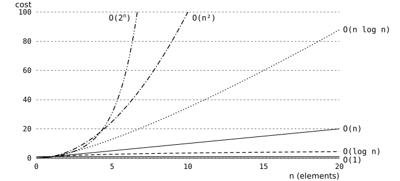

# Big O notation

## What Big O is

To describe how the cost of an operation grows with the number of elements (_n_) provided to a given data structure or algorithm we use the Big O notation.
It measures how the cost grows in relation to the size of the input.

_Big O_ notation applies to the two resources a data structure or algorithm may consume:

- **Time** (_time complexity_): how many steps the operation takes.
- **Memory** (_space complexity_): how much memory the operation or the structure uses.

Big O ignores constant factors, so a cost of _n_ and a cost of _2n_ are both `O(n)`.
It also describes the _worst case_ (i.e.: the cost in the least favourable situation), unless specified otherwise.

Both resources (_time_ and _memory_) follow similar logic when dealing with growth.
These are the most common ones, from the cheapest to the most expensive:

| Complexity   | Name         | When _n_ doubles, the cost…                             |
| ------------ | ------------ | ------------------------------------------------------- |
| `O(1)`       | Constant     | Stays the same.                                         |
| `O(log n)`   | Logarithmic  | Grows by one unit.                                      |
| `O(n)`       | Linear       | Doubles.                                                |
| `O(n log n)` | Linearithmic | Slightly more than doubles.                             |
| `O(n²)`      | Quadratic    | Multiplied by 4.                                        |
| `O(2ⁿ)`      | Exponential  | Squared, because each extra element already doubles it. |

All the complexities that grow at most like _n_ raised to a fixed exponent, such as _n²_ or _n³_, are _polynomial_.
When they are raised to _n_, as `O(2ⁿ)`, they are called _exponential_.

  
   
  <em>Growth curves</em>

These complexities grow at very different rates: the differences are already visible with 10 elements.

### Time complexity

The time complexity of an operation describes how the number of steps changes with the number of elements.

To find the time complexity of an operation you may ask how many elements does the operation have to look at or move.
The table below gives the kind of operation behind each complexity and its time with 1,000 elements, assuming that each step takes 1 µs (one millionth of a second).

| Complexity   | What it means                                                                                  | _n_ = 1,000          |
| ------------ | ---------------------------------------------------------------------------------------------- | -------------------- |
| `O(1)`       | Goes straight to the element. E.g.: `arr[5]`, `map.get(key)`, `stack.pop()`.                | 1 µs                 |
| `O(log n)`   | Each step discards half of what is left. E.g.: binary search, search in a balanced tree.    | 10 µs                |
| `O(n)`       | Looks at each element once. E.g.: `arr.includes(x)`, adding up an array.                    | 1 ms                 |
| `O(n log n)` | Sorts the elements with a good algorithm. E.g.: `arr.sort()`, merge sort.                   | 10 ms                |
| `O(n²)`      | Compares each element with all the others. E.g.: a loop inside a loop, bubble sort.         | 1 s                  |
| `O(2ⁿ)`      | Tries every combination of the elements. E.g.: every subset of a set, naive recursive Fibonacci. | 10287 years |

Some operations are fast almost every time; but now and then one of the calls may be slow due to extra work that the operation has to do.
Their _amortized_ cost is what each call costs on average over many calls, taking into account the occasional slow ones.

For example, adding an element at the end of an array almost always takes one step; however, when the space reserved for the array is full, the array has to be copied to a new, larger space.
Spread over all the calls, each one still costs `O(1)`.

### Memory

The space complexity describes two different amounts of memory:

- **Memory of a structure**: storing _n_ elements takes at least `O(n)` memory.
  Structures differ in what they add to each element, such as pointers or reserved empty slots.
- **Extra memory of an algorithm**: also called _auxiliary space_: the memory that the algorithm needs in addition to the data it receives.
  This is what an interview question such as “what is the space complexity of your solution?” asks about.

The table below lists the most common amounts of extra memory:

| Complexity | What it means                                                                                              |
| ---------- | ---------------------------------------------------------------------------------------------------------- |
| `O(1)`     | A few variables, whatever the size of the input. E.g.: adding up an array, reversing it in place.       |
| `O(log n)` | A recursion _log n_ calls deep; each pending call takes memory. E.g.: recursive binary search, walking a balanced tree. |
| `O(n)`     | A copy of the data, or a record of the values already seen. E.g.: a `Set` of seen values, `map`, `slice`, merge sort. |
| `O(n²)`    | A table of _n_ × _n_ cells. E.g.: an adjacency matrix, dynamic programming over two strings.            |
